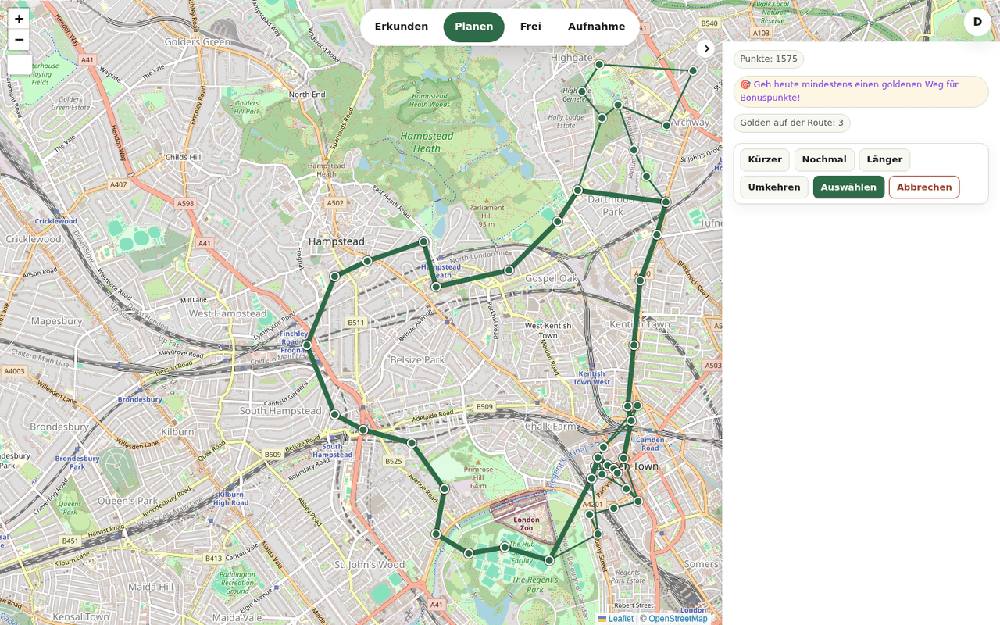
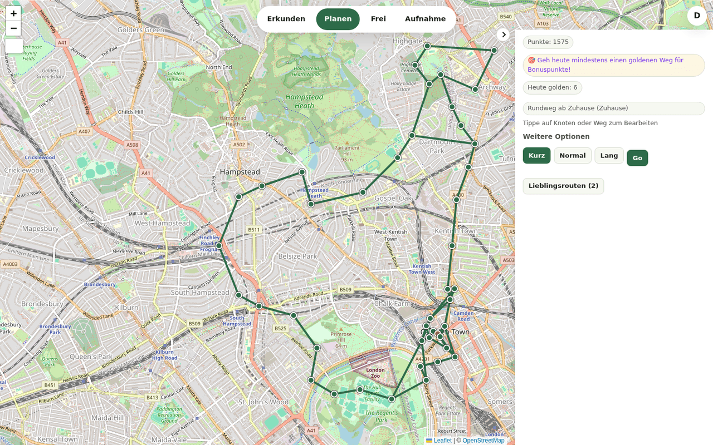
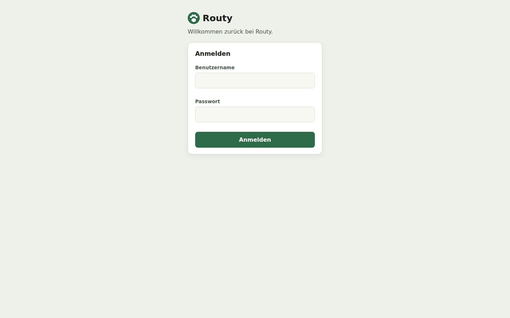
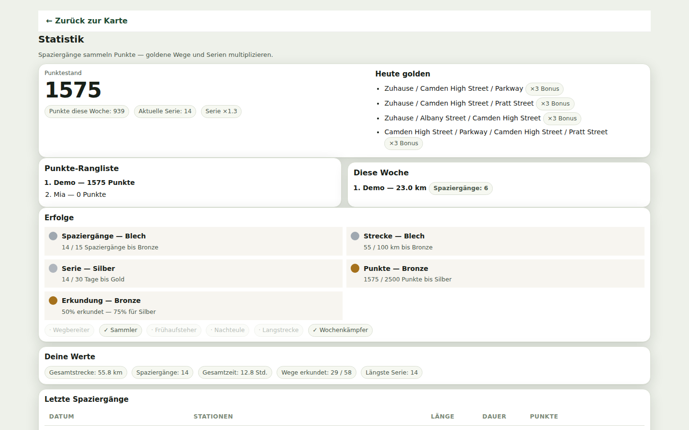
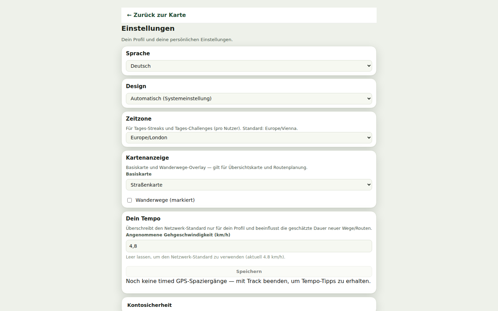

# Routy

> The self-hosted route planner for dog walks — and for any other round you want to log.

**Routy** builds a shared map of the paths your household knows: draw them, import GPX, or record them via GPS while walking. From that shared path network, Routy suggests routes every day — favoring stretches you haven't walked in a long time, and clean loops over awkward out-and-backs.

<details open>
<summary><b>What Routy looks like</b></summary>

| Route planning (web) | Shared path network (web) |
|-|-|
|  |  |

| Login | Stats & game hub | Settings |
|-|-|-|
|  |  |  |

</details>

---

## What Routy can do

- **Build your path network** — draw paths by clicking, import GPX, or record them with GPS while walking. Intersections snap together automatically; names can reuse building blocks (with OSM suggestions). Edit, share, rename, hide and trash paths.
- **Plan routes** — pick a starting point (and optionally waypoints, require/avoid paths). **Short / Normal / Long / Surprise** presets suggest a route in your desired length, ranked by loop quality, variety and a **points preview** (daily golden paths boost your score).
- **Go out** — take a route as an active walk, optionally with a nickname, live location and spoken turn hints. Finishing awards points (preview bonus × streak), a golden-hit celebration, and logs your stats — streaks, achievements and a household leaderboard follow.
- **Restrict paths** — temporarily avoid paths (yourself) or hide them (owner/admin; others can suggest hides). Soft penalties and hides feed into routing.
- **Accounts & permissions** — the first user is admin (users, presets, backups, activity log). Paths belong to their creator; only owner/admin may edit foreign paths. DE/EN UI, several themes and routing parameters in admin settings.

**Clients**

| | Browser (PWA) | [Android app](https://github.com/Emil007/routy-android) |
|---|---|---|
| Route, map, stats | Full web UI + game hub | Native (MapLibre map, offline cache) + game hub |
| GPS recording | Foreground only (browser limitation) | Native foreground service |
| Admin | Web (compact ⋮ menu) | WebView tab (same UI) |
| Account security (password, 2FA) | Settings `#account` | Authenticated in-app WebView sheet |

Map tiles and name/elevation lookups come from public OSM-based services (no API key). See the compose comments if you need an outbound allowlist.

---

## Get started (Docker)

```bash
git clone https://github.com/Emil007/routy.git
cd routy
docker compose pull
docker compose up -d
```

Open the site (port **3000**). On first start, grab the **one-time setup token** from the logs:

```bash
docker compose logs -f
```

Use it to create the first account (becomes admin). No `.env` needed — everything is controlled by `docker-compose.yml`.

| | |
|---|---|
| Data | SQLite under `./data` (bind-mounted) |
| Update | `docker compose pull && docker compose up -d` |
| Health | `GET /api/health` (version, DB, counters, backup time) |
| Restore | [RESTORE_FROM_BACKUP.md](RESTORE_FROM_BACKUP.md) |

For production, put a reverse proxy with HTTPS in front. `COOKIE_SECURE=true` is the default; only set it to `false` for plain HTTP on a LAN.

### Backups (worth it)

- **Manual:** admin page → download a DB snapshot at any time.
- **Automatic:** daily copy in `./data/backups/`, kept for 14 days. Local only — copy it elsewhere for off-site protection.
- Deleted nodes/paths sit in the **trash for 30 days** before being permanently deleted.

### Optional extras

- **HTTPS:** uncomment the Caddy service in `docker-compose.yml`, set `DOMAIN`, open ports 80/443.
- **CAPTCHA** on login/setup: `CAPTCHA_PROVIDER` + site/secret keys in compose.
- **2FA (TOTP):** per user in settings; admin can reset somebody's 2FA lock.

Login and setup are rate-limited by default. The container runs read-only as root with dropped capabilities and memory/CPU limits — see the compose file for details.

---

## Demo data (for trying it out & development)

`scripts/seed-demo/seed.js` generates a **fictional, reusable demo database** — no real locations, but a realistic walking network with London street names (Camden / Hampstead / Highgate), 14 walk logs, favorites and golden paths. Perfect for trying out the game hub without real GPS data.

```bash
node scripts/seed-demo/seed.js
# → writes scripts/seed-demo/data/demo.db
DATABASE_PATH=scripts/seed-demo/data/demo.db npm run dev
```

**Login:** `demo` / `demo1234` (the "demo" user is admin). A ready-made DB ships at `scripts/seed-demo/data/demo.db` and can be used directly.

---

## Develop locally

Node 20+, SQLite under `./data/routy.db`:

```bash
npm install
npm run dev
```

Stack: Next.js (App Router), React, TypeScript, Leaflet, Zod, Vitest. HTTP API notes for the Android client: [docs/API.md](docs/API.md).

Walk sounds (*Purchase Success* / *Brass Fanfare Short* from Pixabay, edited) ship as MP3/OGG in `public/sounds/` (Android `res/raw` uses OGG).

---

## Version numbers

Server and Android share the **same numeric part** for a release batch; only the suffix differs:

| Component | Tag example | Displayed as | Where |
|-----------|-------------|--------------|-------|
| Server | `v0.58s` | **0.58s** | `package.json` |
| Android | `v0.58a` | **0.58a** | `app/build.gradle.kts` |

Pattern is always `0.<number>s` / `0.<number>a` — never swap suffixes, no `b` or semver patches like `0.35.2`.

---

## Acknowledgments

The must-visit ordering and explicit route-quality measurement were inspired by ideas from **[Kōji](https://github.com/TurtIeSocks/Koji)** (TurtIeSocks) — pokemon mapping/geofence routing. Reimplemented natively on Routy's TypeScript graph stack; **no Kōji code was taken**.
